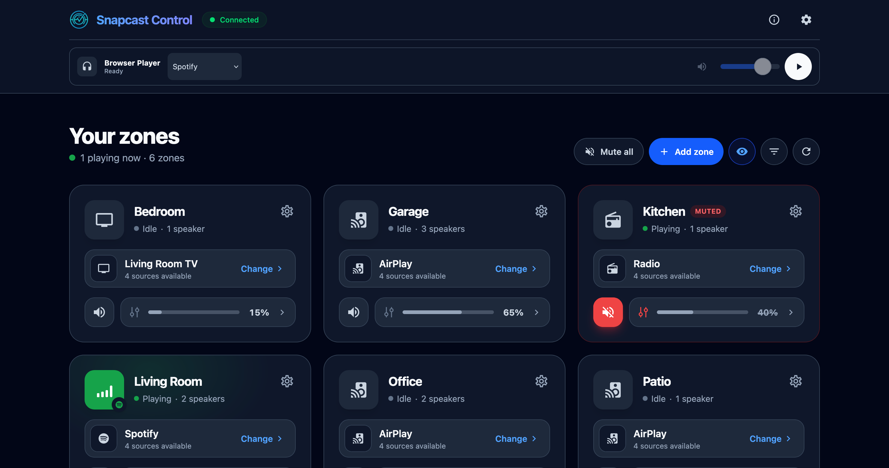
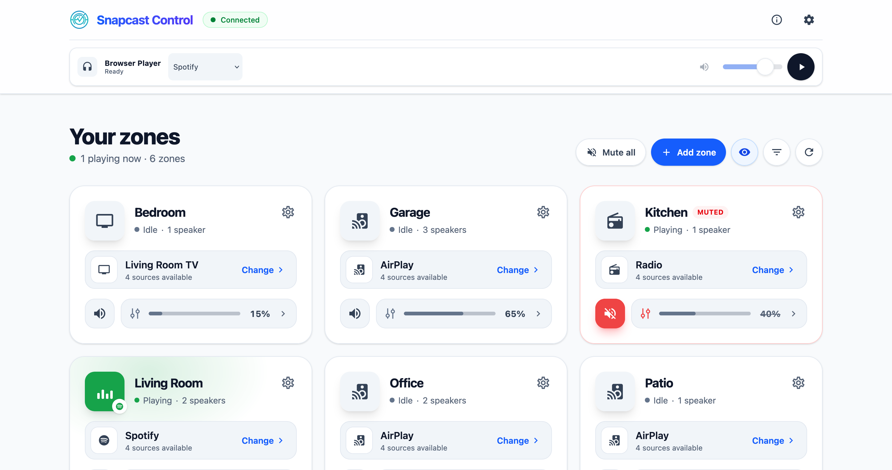
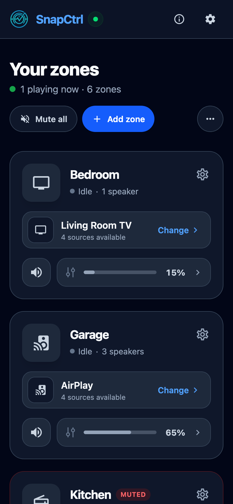
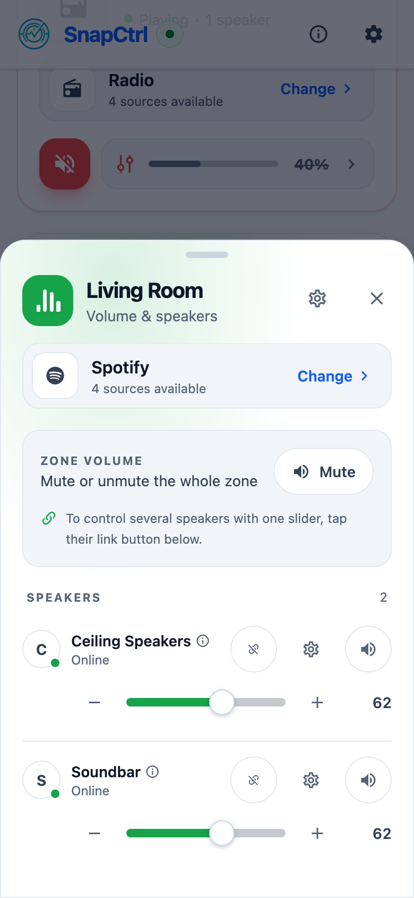

# SnapCtrl

A modern, responsive, and feature-rich web interface for [Snapcast](https://github.com/badaix/snapcast), built with Vue 3 and Tailwind CSS.




<p>
  
  
</p>

## Features

- **Modern & Responsive UI**: A fully responsive interface featuring a sleek dark mode, designed for seamless use on desktop and mobile devices.
- **Real-time Control**: Experience instant updates for volume adjustments, mute toggles, and stream assignments via WebSockets.
- **Comprehensive Group Management**:
  - Easily create, rename, and delete client groups.
  - **Smart Cleanup**: Automatically remove offline or orphaned clients to maintain a tidy setup.
  - **Prevent Orphans**: Enhanced logic ensures deleted groups don't leave behind orphaned clients.
- **Advanced Client Controls**:
  - Visual status indicators (online/offline).
  - Adjust latency calibration and volume levels.
  - Rename clients for better organization.
- **Granular Permissions & Security**:
  - **Lock Mode**: Secure the interface with a passcode to prevent unauthorized changes.
  - **Feature Control**: Enable or disable specific features like volume adjustment, renaming, or group creation.
  - **UI Visibility**: Toggle the visibility of UI elements such as settings, filters, and the browser player.
  - **Access Restrictions**: Restrict access to specific groups, sources, or clients.
- **Smart Volume Memory**:
  - **Per-Source Volume**: Optionally remember volume levels for each source **per group**. Enable this in Group Settings to have clients in that group restore their volume when switching sources.
  - **Per-Browser Memory**: Volume memory (and other UI preferences — theme, hidden groups, group ordering, permissions) is stored in that browser's `localStorage`. It is **not** synced across devices: opening SnapCtrl on your phone and your laptop are two independent memories, each learning its own volumes. Only the actual playback state (current volume, mute, active stream) is shared, because that lives on the Snapcast server itself and reaches every connected device over its WebSocket broadcast.
- **Integrated Browser Player**: Listen to your Snapcast streams directly within the browser, utilizing WASM-based decoders (FLAC, Vorbis, PCM) for high-quality playback.
- **Stream Management**: Intuitive interface for assigning streams to groups.
- **PWA Support**: Install as a Progressive Web App (PWA) on your device for a native-like experience.
- **Development Ready**: Includes optional HTTPS support for local development environments.

## Changelog

See [CHANGELOG.md](CHANGELOG.md) for the full version history, and
[GitHub Releases](https://github.com/NaturalDevCR/snap-ctrl/releases) for
per-release notes and downloadable builds.

## Optional Studio interface

Select **Studio** in the header, or open **Settings → Interface → Studio**.
The original interface remains the default. Switch back with **Classic** in the
Studio header, or **Settings → Interface → Classic**. The choice takes effect
immediately and is remembered in this browser.

Studio puts everything in one compact zone view, without a banner or separate
source and speaker pages. Search by zone, source or speaker; filter playing or
muted zones; and change the source, volume and mute state directly on each card.
Studio has a Midnight blue dark theme and a matching cool blue light theme.

Both interfaces put playing, unmuted zones first, muted zones next, and inactive
or unavailable zones last. Each block keeps your custom zone order (or alphabetical
order if no position is saved). Playback changes never rewrite that preference;
**Manage zones** continues to show the stable manual order while you edit it.
The speaker button beside the source and **Individual volumes** open a dedicated
speaker dialog with volume, mute, linking, details and settings. Cards stay compact
while the dialog is open. It appears as a bottom sheet on phones and a centered
dialog on larger screens.

A zone with one speaker exposes that speaker's volume. Zones with linked speakers
use the existing proportional master volume and control curve. Playback itself is
still controlled in the source application.

Zone creation, visibility and ordering, server information, speaker calibration,
group membership, cleanup, per-source volume memory, application settings,
passcodes and permissions remain available through the shared dialogs. Studio uses
the same stores and WebSocket connection as the original interface. One browser
player instance is shared by both interfaces: changing the interface or resizing
the window preserves playback and does not delete its temporary speaker.

Both interfaces ask for confirmation before muting a zone, an individual speaker,
all visible zones or the browser player. Canceling leaves audio unchanged;
unmuting does not require confirmation. The confirmations are styled app dialogs,
with keyboard focus handling, Escape/backdrop cancellation and live translations.
Changing a source also requires confirmation, including the browser player and
changes saved from zone settings.

Animations respect the operating system's reduced-motion preference. Studio uses
local assets and system fonts, without requiring external font or image services.

Development checks: `pnpm test`, `pnpm run build`, and `pnpm run build:ha`.

## Getting Started

### Prerequisites

- A running [Snapcast server](https://github.com/badaix/snapcast).
- Node.js (v20+) and pnpm (recommended for development).

### Installation

1.  Clone the repository:

    ```bash
    git clone https://github.com/NaturalDevCR/snap-ctrl.git
    cd snap-ctrl
    ```

2.  Install dependencies:

    ```bash
    pnpm install
    ```

3.  Run the development server:

    ```bash
    # HTTP (Default)
    pnpm run dev

    # HTTPS (Optional, for PWA testing)
    pnpm run dev:https
    ```

### Building for Production

To create a static production build compatible with any web server (including Snapcast's built-in server):

```bash
pnpm run build
```

The output will be generated in the `dist` folder. Copy the contents of this folder to your web server's root or Snapcast's `doc_root`.

## Usage with Snapcast

Snapcast server can serve this web interface directly.

1.  Build the project: `pnpm run build`
2.  Locate your Snapcast server's `doc_root` (typically `/usr/share/snapserver/snapweb` or defined in `/etc/snapserver.conf`).
3.  Backup the existing `index.html` and assets.
4.  Copy the contents of the `dist` folder to the `doc_root`.
5.  Access the interface via `http://<snapserver-ip>:1780`.

## GitHub Release Workflow

This project includes a GitHub Actions workflow that automatically builds and releases the application.

To create a new release:

1.  Push your changes to the `main` branch.
2.  Create and push a tag starting with `v` (e.g., `v0.4.0`):
    ```bash
    git tag v0.4.0
    git push origin v0.4.0
    ```
3.  GitHub Actions will automatically build the project and create a release with a `dist.zip` file attached.

## Security Notes

The optional passcode is a **client-side UX guard**, not a real authentication layer:

- It is stored as a salted PBKDF2-SHA256 hash in `localStorage`. Anyone with access to the browser can clear `localStorage` and bypass it.
- The granular permissions (`canAdjustVolumes`, `canRenameGroups`, etc.) are enforced only inside the UI. A user that reaches the Snapcast JSON-RPC endpoint directly (default `ws://<host>:1780/jsonrpc`) can issue any `Client.SetVolume` / `Group.SetStream` etc. without going through the SnapCtrl checks.

For real access control, place Snapcast behind a reverse proxy that enforces authentication (e.g. nginx with `auth_basic` or Caddy with `basicauth`), or run snap-ctrl in a network you trust. SnapCtrl will use the same credentials transparently.

`window.crypto.subtle` is required (HTTPS or `localhost`). The app will refuse to set a passcode over an insecure origin.

### Content Security Policy

A `Content-Security-Policy` is set via a `<meta>` tag in `index.html` as a defense-in-depth fallback. **One directive cannot be set this way: `frame-ancestors`**. Per the CSP spec, `frame-ancestors` is silently ignored when delivered via `<meta>` and must come from a response header. If you serve SnapCtrl behind your own web server or reverse proxy, make sure the response includes:

```
Content-Security-Policy: ...; frame-ancestors 'self'
```

The bundled HA addon (`addon/nginx.conf`) already does this. For the standalone static build (`dist/`), configure your reverse proxy accordingly — see the `addon/nginx.conf` block for the exact policy.

## Support This Project

If you find this project useful and want to support its development, consider buying me a coffee! ☕

[](https://paypal.me/NaturalCloud)

Your donations help keep this project maintained and improved. Thank you for your support! ❤️

## Acknowledgments

This project was inspired by and uses concepts from [Snapweb](https://github.com/badaix/snapweb), the official web interface for Snapcast. SnapCtrl is a complete rewrite with a custom design and implementation. We are grateful to the Snapcast team for their excellent work on the reference implementation and for maintaining the amazing Snapcast ecosystem.

## Notice

This project was developed with the assistance of advanced AI coding agents (Gemini 1.5 Pro and Sonnet 3.5), blending automated code generation with human oversight and customization.

## License

MIT

## Language, palettes and app icon

Choose **Settings → Language** to switch between **English** and **Español**.
The two language buttons avoid native dropdown menus. Labels, dialogs,
confirmations and accessibility text change immediately in both
interfaces. Zone, source and speaker names stay as configured on the server.
Language and palette choices are local to each browser.

Studio includes four palettes in **Settings → Studio color palette**: Midnight
(default), Ocean, Aurora and Ember. Each supports light and dark mode. Playing
zones have a highlighted edge, tinted surface and animated equalizer; muted and
unavailable zones have distinct icons and borders. Motion respects the system's
reduced-motion setting.

The new installed-app icon includes Apple, standard PWA and maskable Android
exports. See [icon source and generation prompt](docs/branding/app-icon.md).
